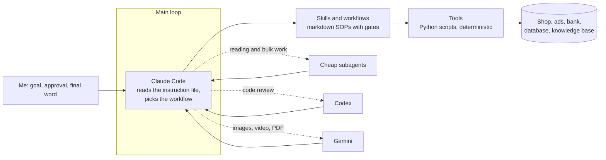

# Claude Code operating system

This is how I run a small e-commerce business with Claude Code as the daily operator.

I own the brand and for years did almost every job in it by hand: orders, shipping, bookkeeping, support, content, ads. Over the past year I rebuilt those jobs as processes that an agent runs and I approve. This repository is the brand-neutral extract of that setup: the instruction file the agent reads at the start of every session, the rules for choosing a model, the hooks, one skill, and a few tools.

The working repositories stay private. They hold customer data, finances and the brand voice. Everything here is taken from them, translated to English and cleaned of names, business figures and keys.

## The idea

Models reason. Code executes. Keeping those two apart is what makes the system reliable.

- **Workflows and skills** are markdown procedures. Each one says what to do, in which order, and where the gate is.
- **The agent** reads the procedure, runs the tools in order, handles failures and asks me when a decision is mine.
- **Tools** are plain Python scripts. They call APIs, move data and print numbers. Keys live in `.env` and nowhere else.

## What is inside

| Path | What it is | Why it exists |
|---|---|---|
| [CLAUDE.md](CLAUDE.md) | The instruction file the agent loads every session | One place for process rules, so they do not live in my head |
| [docs/model-routing.md](docs/model-routing.md) | Which model does which job, and what it costs to get it wrong | The expensive model should think, not rename files or stare at screenshots |
| [docs/memory-and-knowledge.md](docs/memory-and-knowledge.md) | How the agent remembers, and how it reads the knowledge base without drowning in it | A session starts cold. Without this every session starts from zero |
| [skills/three-brain-router](skills/three-brain-router/SKILL.md) | A skill that sends code review to Codex and media to Gemini, and keeps brand copy inside Claude | Second opinions that do not spend the main model's limits |
| [hooks/](hooks/) | Three hooks and one helper: trim noisy output, check goals against open decisions, kill stuck browsers | Rules the agent keeps forgetting become code that cannot be skipped |
| [tools/](tools/) | Four tools from the working set: media analysis, screenshot blurring, readability scoring | Examples of the deterministic half |

## Rules that shaped it

1. **By hand first.** I automate only a job I have done myself enough times to know where it breaks.
2. **The model thinks, code executes.** If a step can be a script, it is a script. The agent calls it and reads the result.
3. **The cheapest path to the same result.** Quality is not traded. Where two routes give the same answer, I take the one that does not burn the context window. Measuring a layout with code costs about 200 tokens. Looking at the screenshot costs about 40,000.
4. **Verification takes a different route than the work.** Code is reviewed by another model. Copy passes a gate skill. A file is checked in the place where the recipient will open it.
5. **The last word is human.** The agent prepares the judgment and argues for it. I sign it. Open decisions that only I can make sit in a queue, and that queue outranks any new build.

## Size

As of 10 October 2026 the private setup behind this extract holds 88 Python tools and data collectors, 18 project skills, 214 memory notes and a knowledge base of 188 pages. The agent repositories are committed automatically every evening.

## What runs on it

- Case studies with screenshots: [holovko-ai.pages.dev](https://holovko-ai.pages.dev)
- One process published in full: [shopify-checkbox-fiscal](https://github.com/Alhol18/shopify-checkbox-fiscal), a Cloudflare Worker that issues fiscal receipts for paid Shopify orders

## Using it

Nothing here needs installing. Read [CLAUDE.md](CLAUDE.md) first, then [docs/model-routing.md](docs/model-routing.md). To try the hooks, copy the files from `hooks/` and wire them as shown in [hooks/settings.example.json](hooks/settings.example.json).

## License

MIT. See [LICENSE](LICENSE).
